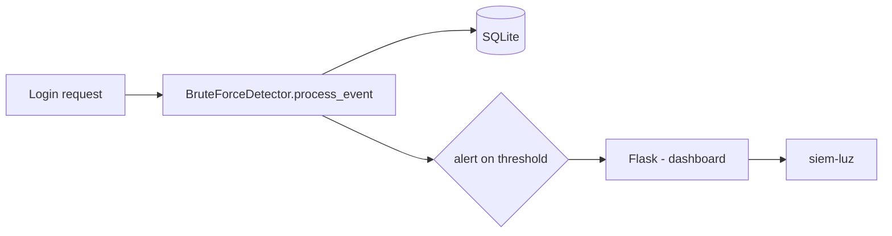

# siem-luz-brute-force

**English** · [Português (Brasil)](README.md)

[](#) [](#) [](#) [](#) [](LICENSE)

## What it is

A **lightweight brute-force detection SIEM**: a detector that counts **consecutive login failures per (user, IP) pair** and raises an alert when the threshold is reached (default: **10 failures**). It includes a small **Flask** application with a dashboard to view events, alerts and authentications. Data is persisted in SQLite.

## Status

An educational security lab, working, with 8 tests.

> **Warning (verified by the agent):** the repository contains **committed duplicated structure** (`src/src/…` and `tests/tests/…`). Because of this, `pytest tests/` fails at collection ("import file mismatch"). The **8 tests pass** with `PYTHONPATH=src pytest tests/test_*.py`. See `HYGIENE.md`.

## Features

- **Brute-force detector** (`BruteForceDetector`): consecutive-failure threshold per (user, IP), with SQLite persistence.
- **Flask application** with auth, alerts, events and dashboard routes.
- **Web dashboard** showing the threshold, counters and event history.
- **CLI**: `siem-luz` (configurable DB path via `--db`).

## Architecture

A `siem_luz` package with `detection.py` (business rule), `database.py` (SQLite persistence), `models.py` (data) and `app.py` (Flask + dashboard + CLI). The `process_event` pipeline updates the counter and raises an alert on threshold.



## Stack

- Python ≥ 3.10
- Flask ≥ 3.0
- SQLite (stdlib `sqlite3`)
- pytest (dev), ruff (dev)

## Repository layout

```
siem-luz-brute-force/
├── pyproject.toml · BRIEF.md
├── src/siem_luz/
│   ├── detection.py   # brute-force rule
│   ├── database.py    # SQLite persistence
│   ├── models.py
│   └── app.py         # Flask + dashboard + CLI
├── tests/             # test_app.py, test_detection.py
├── (committed duplicates: src/src/…, tests/tests/…)  # see HYGIENE
└── LICENSE            # MIT
```

## Prerequisites and installation

Python ≥ 3.10.

```bash
pip install -e .
```

## How to run

```bash
siem-luz --db data/siem.db     # start the Flask application
# open the dashboard at the printed address
```

## Tests and quality

Real run (verified by the agent):

```bash
PYTHONPATH=src python -m pytest tests/test_detection.py tests/test_app.py -q
# 8 passed
```

> `pytest tests/` (without `PYTHONPATH`/with duplication) fails at collection — see Status above.

## Technical decisions and trade-offs

- **Per (user, IP) rule** instead of IP-only: avoids false positives on shared networks; on the flip side, a distributed attack across many IPs may not trigger.
- **SQLite** for persistence: simple and local, right for a lab SIEM.
- **Pragmatic detection** (consecutive-failure threshold) instead of ML: transparent and light.

## Known limitations and roadmap

- Simple in-memory/DB trend; no long history or correlation across multiple services.
- The code is a lab; production would require auth hardening and centralized collection.
- The duplicated folder structure needs cleanup for `pytest tests/` to work (a proposal in `HYGIENE.md`).

## Development process

An individual project by Kelvin Oliveira, built with orchestrated AI agents and reviewed by the author. The detection rule, the dashboard and the review are the author's.

## License and author

MIT — Copyright (c) 2026 Kelvin Rebelo de Oliveira.

**Author**: [Kelvin Oliveira](https://github.com/KelvinOliveiraCode) · [Portfolio](https://kelvinoliveiracode.github.io/portfolio/)
