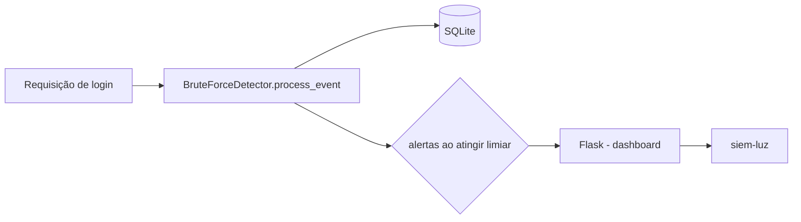

# siem-luz-brute-force

[English](README.en.md) · **Português (Brasil)**

[](#) [](#) [](#) [](#) [](LICENSE)

## O que é

**SIEM leve de detecção de brute force**: um detector que conta **falhas consecutivas de login por par (usuário, IP)** e dispara um alerta quando o limiar é atingido (padrão: **10 falhas**). Inclui uma pequena aplicação **Flask** com dashboard para visualizar eventos, alertas e autenticações. Dados persistidos em SQLite.

## Status

Laboratório educacional de segurança, funcional, com 8 testes.

> **Aviso (verificado pelo agente):** o repositório contém **estrutura duplicada commitada** (`src/src/…` e `tests/tests/…`). Por isso `pytest tests/` falha na coleta ("import file mismatch"). Os **8 testes passam** com `PYTHONPATH=src pytest tests/test_*.py`. Ver `HYGIENE.md`.

## Funcionalidades

- **Detector de brute force** (`BruteForceDetector`): limiar de falhas consecutivas por (usuário, IP), com persistência SQLite.
- **Aplicação Flask** com rotas de autenticação, alertas, eventos e dashboard.
- **Dashboard** web mostrando limiar, contadores e histórico de eventos.
- **CLI**: `siem-luz` (caminho do banco configurável via `--db`).

> Descrição do GitHub diz "projeto funcional"; o código é um laboratório SIEM — documentado pelo que faz.

## Arquitetura

Pacote `siem_luz` com `detection.py` (regra de negócio), `database.py` (persistência SQLite), `models.py` (dados) e `app.py` (Flask + dashboard + CLI). Middleware `process_event` atualiza a contagem e emite alerta ao atingir o limiar.



## Stack

- Python ≥ 3.10
- Flask ≥ 3.0
- SQLite (stdlib `sqlite3`)
- pytest (dev), ruff (dev)

## Estrutura do repositório

```
siem-luz-brute-force/
├── pyproject.toml · BRIEF.md
├── src/siem_luz/
│   ├── detection.py   # regra de brute force
│   ├── database.py    # persistência SQLite
│   ├── models.py
│   └── app.py         # Flask + dashboard + CLI
├── tests/             # test_app.py, test_detection.py
├── (duplicados commitados: src/src/…, tests/tests/…)  # ver HYGIENE
└── LICENSE            # MIT
```

## Pré-requisitos e instalação

Python ≥ 3.10.

```bash
pip install -e .
```

## Como executar

```bash
siem-luz --db data/siem.db     # sobe a aplicação Flask
# acesse o dashboard no endereço exibido
```

## Testes e qualidade

Execução real (verificada pelo agente):

```bash
PYTHONPATH=src python -m pytest tests/test_detection.py tests/test_app.py -q
# 8 passed
```

> `pytest tests/` (sem `PYTHONPATH`/com duplicação) falha na coleta — ver Status acima.

## Decisões técnicas e trade-offs

- **Regra por pares (usuário, IP)** em vez de só IP: evita falsos positivos em redes compartilhadas; em troca, um ataque distribuído por muitos IPs pode não disparar.
- **SQLite** para persistência: simples e local, adequado a um SIEM de laboratório.
- **Detecção pragmática** (limiar de falhas consecutivas) em vez de ML: transparente e leve.

## Limitações conhecidas e roadmap

- Monotónica em memória/banco simples; sem histórico longe nem correlação entre múltiplos serviços.
- O código é um laboratório; produção exigiria hardening de auth e coleta centralizada.
- A estrutura de pastas duplicada precisa de limpeza para `pytest tests/` funcionar (proposta em `HYGIENE.md`).

## Processo de desenvolvimento

Projeto individual de Kelvin Oliveira, construído com agentes de IA orquestrados e revisado pelo autor. A regra de detecção, o dashboard e a revisão são do autor.

## Licença e autor

MIT — Copyright (c) 2026 Kelvin Rebelo de Oliveira.

**Autor**: [Kelvin Oliveira](https://github.com/KelvinOliveiraCode) · [Portfólio](https://kelvinoliveiracode.github.io/portfolio/)
